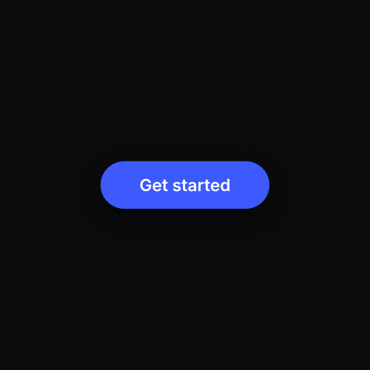

# pagereel

[](https://github.com/iliev-blnk/pagereel/actions/workflows/ci.yml)

Render any web page to video: MP4, WebM (with transparency), GIF or PNG frames, frame-exact.



Pages with CSS animations, transitions, `requestAnimationFrame` loops or timers render as they
are, with no changes. Pages that want full control expose `seek(t)` and paint any moment on
demand. **[See the gallery →](https://iliev-blnk.github.io/pagereel/)** Every video there is
rendered by CI from the example next to it.

## Install

```sh
npm install pagereel
```

pagereel drives Chrome or Chromium and encodes with ffmpeg. It finds an installed Chrome by
itself (or run `npx playwright install chromium`), and needs `ffmpeg` on your PATH
(`brew install ffmpeg`, `apt install ffmpeg`, or [ffmpeg.org](https://ffmpeg.org)).

## Quickstart

Any page, no code changes:

```sh
npx pagereel render https://example.com/promo --duration 8 --size 1080x1920 -o promo.mp4
npx pagereel render banner.html --duration 6 --transparent -o banner.webm
```

Or take control of every frame. The page tells pagereel how long it is and how to paint a moment:

```html
<canvas id="c" width="1080" height="1080"></canvas>
<script>
  const g = document.getElementById('c').getContext('2d')
  window.pagereel = {
    duration: 4, fps: 60, width: 1080, height: 1080, loop: true,
    seek(t) {
      g.clearRect(0, 0, 1080, 1080)
      g.fillRect(540 + 300 * Math.sin(t * Math.PI / 2) - 50, 490, 100, 100)
    },
  }
</script>
```

```sh
npx pagereel render scene.html -o scene.mp4
```

## Two modes

pagereel opens the page and picks a mode (`--mode` overrides it).

**Clock mode** is for pages that don't know about pagereel. Before any page script runs,
pagereel replaces every source of time the page can read: `performance.now`, `Date`,
`setTimeout`, `setInterval`, `requestAnimationFrame` and `Math.random` (seeded). It pauses every
CSS animation and transition and places it at each frame's time. A transition started by a timer
at 1 s starts at 1 s in the video. `--duration` is required.

**Scene mode** is for pages that set `window.pagereel`:

| Field | |
|---|---|
| `seek(t)` | Paint the frame for `t` seconds. May return a Promise, e.g. to wait for an image. |
| `duration` | Seconds. |
| `fps`, `width`, `height` | Defaults; CLI flags override them. |
| `loop` | `true` turns on the loop check in `stills`. |
| `audio` | Path or URL of a track to mux in. |
| `ready` | A Promise to wait for before the first frame (fonts, assets). |

A scene can go back in time, so it renders and previews exactly. Use it for films, data
visualisations and anything driven by your own timeline.

## Commands

```
pagereel render  <url|file> [-o out.mp4] [options]   render a video or PNG frames
pagereel stills  <url|file> [-o dir]                  frames + contact sheet + loop check
pagereel preview <url|file>                           open the page with a scrub bar
```

| Option | |
|---|---|
| `-o, --output` | Output file; a folder for `--format png` and `stills`. |
| `--duration s` | Length in seconds. |
| `--size WxH` | Viewport, default 1280x720 or the scene's own. |
| `--fps n` | Default 30 or the scene's own. |
| `--scale n` | Device scale factor. A 1080x1080 page at `--scale 2` gives 2160x2160. |
| `--from s`, `--to s` | Render part of the timeline. |
| `--workers n` | Parallel browser pages, default up to 6. |
| `--audio file` | Track to mux in (mp4, webm). |
| `--format f` | `mp4`, `webm`, `gif` or `png`; default from the output extension. |
| `--transparent` | Keep a transparent page background (webm, png). |
| `--seed n`, `--epoch ms` | `Math.random` seed and `Date.now()` at t=0, in clock mode. |
| `--root dir` | Folder to serve for a local file (default: the file's folder). |
| `--count n`, `--at t1,t2` | Which frames `stills` captures. |

`stills` writes PNGs and a `contact.png` sheet. For a scene with `loop: true` it also compares
the first and last frame and reports whether the loop is seamless.

## Node API

```js
import { render, stills } from 'pagereel'

await render({
  source: 'scene.html',
  output: 'scene.mp4',
  onProgress: ({ frame, total }) => console.log(`${frame}/${total}`),
  signal: AbortSignal.timeout(60_000),
})

const { contactSheet, loop } = await stills({ source: 'scene.html', count: 9 })
```

Options match the CLI flags (`size`, `fps`, `scale`, `from`, `to`, `workers`, `audio`,
`transparent`, `format`, `mode`, `seed`, `epoch`, `root`). Expected failures, such as a page
that won't load, odd video dimensions or a cancelled render, throw `PagereelError` with a
one-line message.

## Helpers

Two optional modules for building scenes:

- **`pagereel/motion`**: closed-form springs (`spring`, `track`, `colorTrack` with `snappy`,
  `default`, `heavy` and `playful` presets), a beat grid (`beats(bpm)`), eases, `fade` and a
  seeded `rng`. Every function is pure in `t`, so any frame can be computed on its own.
- **`pagereel/audio`**: a small synth (`kick`, `hat`, `snare`, `bass`, `pad`, `bell`, `whoosh`
  and more) that writes a WAV from cues on the same beat grid as the picture. Node only.

[`examples/one-shape`](examples/one-shape) uses both: a UI film and its soundtrack scored from
one `timeline.js`.

## How it works

Each worker opens its own page and renders one contiguous slice of the video, capturing frames
with the Chrome DevTools protocol and streaming them straight into its own ffmpeg as lossless
FFV1. A clock-mode page can't go back in time, so a worker reaches the start of its slice by
running every earlier frame without capturing; the same code path and the same seed make
slices join without a seam. One final ffmpeg pass joins the slices, encodes the target format
once and muxes the audio.

## Limits

- Clock mode can't control `<video>` and `<audio>` playback, WebGL or workers that read time
  from elsewhere, or content that arrives over the network after the page loads. Scene mode
  covers all of these: your `seek(t)` decides what is on screen.
- MP4 and WebM need an even width and height (after `--scale`).
- ffmpeg is not bundled.

## Related

[pagepad](https://github.com/iliev-blnk/pagepad) turns a phone into a remote for any web page.

## License

MIT
